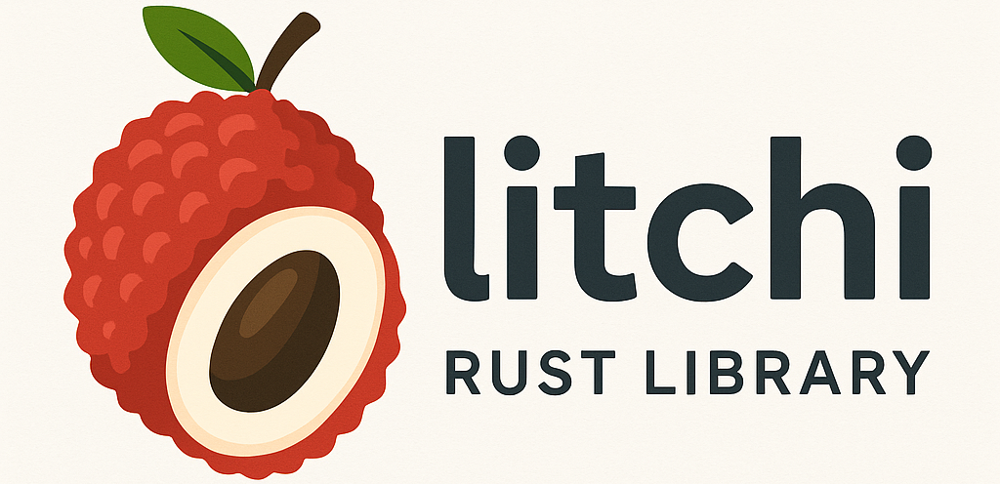

# Litchi

<p align="center">
  
</p>

A high-performance Rust library for parsing Microsoft Office file formats (OLE2 and OOXML), OpenDocument formats (ODF), and Apple iWork files. Supports .doc, .docx, .xls, .xlsx, .ppt, .pptx, .odt, .ods, .odp, .pages, .numbers, and .key files.

> [!WARNING]
> ⚠️ **Active Development**: This library is under active development. The API may change without notice. **Not recommended for production use yet.**

> [!NOTE]
> The current logo is generated by AI, we need someone to design a better logo. If you are interested, please contact me via [email](mailto:ryker.zhu@outlook.com).

## Features

- **Complete CRUD Operations** - Create, read, update, and save Office documents (.docx, .xlsx, .pptx) through the per-format modules
- **Unified API** - `litchi::open` reads legacy, OOXML, and OpenDocument files into one `File` type, detecting the format from the content, with typed errors that carry a stable code and a suggestion
- **Microsoft Office** - Full support for .doc, .docx, .xls, .xlsx, .xlsb, .ppt, .pptx files
- **OpenDocument** - Parse .odt, .ods, .odp files (ODF format)
- **Apple iWork** - Independently parse .pages, .numbers, and .key files through dedicated format leaves
- **Formula Conversion** - Parse MathType and Office MathML equations and convert to LaTeX
- **Markdown Conversion** - Convert documents and presentations to Markdown format
- **Memory Efficient** - Direct byte buffer support with zero-copy parsing where possible
- **High Performance** - SIMD optimizations, minimal allocations, efficient memory layout

OOXML ownership is split by responsibility: `litchi-opc` owns the package graph,
`litchi-ooxml-common` owns shared OOXML vocabulary and package services,
`litchi-docx`, `litchi-pptx`, `litchi-xlsx`, and `litchi-xlsb` own their format
semantics, and `litchi-fonts` owns font discovery, subsetting, embedding, and
obfuscation. The `litchi` facade exposes each namespace only when its matching
opt-in feature is enabled.

OOXML ingestion is bounded by `litchi_opc::ReadLimits`. The standard profile is
used by ordinary open methods; applications that receive untrusted or
multi-tenant input can derive a tighter checked profile with
`ReadLimits::builder()` and pass it to the contextual DOCX, PPTX, XLSX, or XLSB
`*_with_limits` entry point. The policy covers package input, ZIP members and
metadata, materialized OPC parts, `[Content_Types].xml`, and relationship XML
and graph traversal. It implements the defensive-consumer concerns in
ECMA-376 Part 2 sections 7.3.6 and 10, together with MS-OI29500 sections
2.1.1749-1752; its ceilings are Litchi safety policy, not maxima prescribed by
those specifications.

PPTX and XLSX custom document properties use the shared typed
`litchi_ooxml_common::custom::Props` and `Value` model for parsing and writing,
following vendored `MS-OI29500` §3.11. A missing custom-properties part is an
empty `Props`; mutations are transactional and invalidate package signatures.
Property values are inert data: Litchi never executes macros, VBA, ActiveX,
controls, OLE objects, embedded code, actions, formulas, or links. Macro, VBA,
ActiveX, control, OLE, and embedded-code payloads are retained only as inert
blobs when exposed or preserved; they are never executed or activated.

## Quick Start

Unless a section says otherwise, its snippets run inside a function that
returns `litchi::Result<()>`.

### Open any document

`litchi::open` detects the format from the file's content and returns a
`File`: an enum with one variant per format (`File::Docx`, `File::Xls`,
`File::Ppt`, ...), plus `File::Locked` for an encrypted file and
`File::Signed` for a signed one. The common case needs no options and no
format knowledge.

```rust
let file = litchi::open("report.docx")?; // or .doc, .rtf, .odt, .xlsx, .pptx, ...
println!("format: {:?}, family: {:?}", file.format(), file.family());

// Reads that every format shares are methods on `File`.
println!("{}", file.text()?);
if let Some(metadata) = file.metadata()? {
    println!("title: {:?}", metadata.title);
}

// Family reads go through a view: `document()`, `presentation()` or
// `workbook()`. A view refuses a file of another family.
for paragraph in file.document()?.paragraphs()? {
    println!("{}", paragraph.text()?);
}
```

Presentations and workbooks work the same way:

```rust
let deck = litchi::open("slides.pptx")?; // or .ppt, .odp
let presentation = deck.presentation()?;
println!("{} slides", presentation.slide_count()?);
for slide in presentation.slides()? {
    println!("{}", slide.text()?);
}

let book = litchi::open("budget.xlsx")?; // or .xls, .xlsb, .ods
println!("sheets: {:?}", book.workbook()?.worksheet_names()?);
```

The workbook view also implements the generic `litchi::sheet::WorkbookTrait`
by static dispatch, so `litchi::sheet::FormulaEvaluator` (`eval` feature) can
evaluate formulas on it directly; see the `sheet_eval_*` examples.

Format-specific reads live on the handle that each variant carries:

```rust
use litchi::File;

match litchi::open("budget.xlsx")? {
    File::Xlsx(xlsx) => {
        // XLSX sheet names match case-insensitively, as in Excel.
        if let Some(sheet) = xlsx.sheet("data")? {
            println!("{}: A1 = {:?}", sheet.name(), sheet.cell("A1")?);
        }
    },
    File::Pptx(pptx) => println!("slide size: {:?} EMU", pptx.slide_size()?),
    other => println!("{:?}", other.format()),
}
```

With the `markdown` feature, documents and presentations convert to Markdown:

```rust
use litchi::markdown::ToMarkdown;

let file = litchi::open("report.docx")?;
println!("{}", file.to_markdown()?);
```

### Encrypted and signed files

An encrypted file opens as `File::Locked`. Reading it fails with
`document_protected` and a suggestion to unlock it. With the `encryption`
feature, `Locked::unlock` consumes the handle and opens the content with its
password; a password never passes through `OpenOptions`.

```rust
use litchi::{File, Password};

let file = match litchi::open("protected.doc")? {
    File::Locked(locked) => {
        println!("{:?} encrypted with {:?}", locked.format(), locked.encryption());
        locked.unlock(Password::new("password".to_owned()))?
    },
    file => file,
};
println!("{}", file.text()?);
```

A signed OOXML or legacy binary file opens as `File::Signed`. It reads like
any other file, and nothing is verified when it opens. So that no edit can
strip a signature silently, editing a signed file requires removing the
signature explicitly first: `Signed::unsign` consumes the signature and
returns the file. (The unified edit verbs themselves are not available yet;
see below.)

```rust
use litchi::File;

let file = litchi::open("contract.docx")?;
println!("{}", file.text()?); // reads the signed content
if let File::Signed(signed) = file {
    println!("{:?} signature in the {:?} container", signed.format(), signed.origin());
    let unsigned: File = signed.unsign();
    assert!(!unsigned.is_signed());
}
```

### Errors

Every failure of the unified API is one `litchi::Error`. It carries a stable
`Code` (`code().as_str()` is the `snake_case` wire name), a message, an
optional suggestion, the format involved, and the typed error of the format
crate that failed, which `std::error::Error::source` returns.

```rust
use litchi::Code;

match litchi::open("notes.pages") {
    Ok(file) => println!("{}", file.text()?),
    Err(error) if error.code() == Code::UnsupportedFormat => {
        // `detected` names the format that was recognized: Some(Pages) here.
        println!("{:?}", error.detected());
        // "open Pages, Keynote and Numbers files with `litchi::iwork::Document::open`"
        if let Some(suggestion) = error.suggestion() {
            println!("{suggestion}");
        }
    },
    Err(error) => return Err(error),
}
```

The codes that opening and reading report most often:

| Code | When |
|---|---|
| `file_not_found` | The path does not exist. |
| `unsupported_format` | The input is not an Office file (`detected()` is `None`), or `litchi::open` does not open its format (`detected()` names it; Apple iWork files and formats whose cargo feature is off come with a suggestion). A family view reports it too, for a file of another family. |
| `corrupt_file` | A container, record, XML part, or payload is malformed. |
| `limit_exceeded` | The input exceeds a read limit. The suggestion is to raise the matching limit in `OpenOptions` if the input is trusted. |
| `document_protected` | A `File::Locked` was read. The suggestion names `Locked::unlock`. |
| `invalid_argument` | `Locked::unlock` was given the wrong password. The suggestion is to check it. |
| `io_error` | Reading failed, or a file opened from a path changed after it was opened. |
| `unsupported_capability` | The format cannot do what was asked, such as Markdown output of a workbook or unlocking an encrypted XLSB package. |
| `cancelled` | The execution context in `OpenOptions` was cancelled. |

### What the unified API does not do yet

- **Editing.** `File` reads; it does not write. The unified edit verbs
  (`set`, `add`, `remove`, batches, `save`, `create`) and path queries are
  planned for later releases. Until then, write documents through the
  per-format modules shown below.
- **Apple iWork.** `litchi::open` recognizes Pages, Keynote, and Numbers files
  but does not open them: it returns `unsupported_format` with a suggestion.
  Read them through `litchi::iwork` (below) or the `litchi::pages`,
  `litchi::keynote`, and `litchi::numbers` modules.
- **Other OpenDocument formats.** Drawings, charts, images, databases,
  templates, masters, and formulas (`.odg`, `.odc`, `.odi`, `.odb`, `.oth`,
  `.odm`, `.odf`) are not opened by `litchi::open` yet.

### Creating and Writing Documents

The per-format modules create and edit documents. They report their own
error types, so the snippets in this section and the next run inside a
function that returns `Result<(), Box<dyn std::error::Error + Send + Sync>>`.

```rust
use litchi::docx::Package;
use litchi::pptx::Package as PptxPackage;
use litchi::xlsx::Workbook;

// Create Word document
let mut pkg = Package::new()?;
let doc = pkg.document_mut()?;
doc.add_heading("My Document", 1)?;
doc.add_paragraph_with_text("Hello, World!");
pkg.save("output.docx")?;

// Create Excel workbook: edits are transactions over an immutable workbook
let mut edit = Workbook::create()?.edit()?;
edit.sheet("Sheet1")?
    .ok_or("missing worksheet")?
    .set("A1", "Hello")?
    .set("B1", "World")?;
edit.commit()?.into_workbook().save("output.xlsx")?;

// Create PowerPoint presentation
let mut pkg = PptxPackage::new()?;
let pres = pkg.presentation_mut()?;
let slide = pres.add_slide()?;
slide.set_title("My Presentation");
pkg.save("output.pptx")?;
```

### Additional Format Support

```rust
// Pages, Keynote, and Numbers documents, read once (requires "iwork")
#[cfg(feature = "iwork")]
{
    use litchi::iwork::Document;

    let document = Document::open("budget.numbers")?; // or .pages, .key, or a package directory
    let snapshot = document.snapshot();
    println!("{}: {}", document.format(), snapshot.summary());
    for text in snapshot.iter_text() {
        println!("{:?}: {}", text.role(), text.value());
    }
}

// Formula conversion (requires the "formula" feature)
#[cfg(feature = "formula")]
{
    use litchi::formula;
    let latex = formula::omml_to_latex("<m:oMath><m:r><m:t>x</m:t></m:r></m:oMath>")?;
    println!("{latex}");
}
```

## Installation

> [!NOTE]
> The crates.io release may lag the focused edit and reversible-patch APIs in
> development. Use the development version when you need those newer
> transaction surfaces.

Add to your `Cargo.toml`:

```toml
[dependencies]
litchi = { version = "0", features = ["docx"] }

# Or use the development version
litchi = { git = "https://github.com/DevExzh/litchi.git", features = ["docx"] }
```

### Optional Features

Default features are empty. Choose precisely the file formats and capabilities
your application uses; `default-features = false` is therefore optional, but
can make that intent explicit.

```toml
[dependencies]
# Legacy PowerPoint, OOXML PowerPoint, and signing support.
litchi = { version = "0", features = ["ppt", "pptx", "sign"] }

# A minimal spreadsheet reader/writer surface.
litchi = { version = "0", default-features = false, features = ["xlsx"] }

# Parse only Pages documents. `keynote` and `numbers` are independent leaves.
litchi = { version = "0", features = ["pages"] }

# Enable every iWork format as a convenience bundle.
litchi = { version = "0", features = ["iwork"] }
```

Formats never imply signing. Add `sign` only when your application needs
signature support.

**Note about iWork leaves:** `pages`, `keynote`, and `numbers` parse serialized
IWA Protocol Buffer messages. Enabling any one of them requires a system
`protoc` installation (used by `prost-build`); `iwork` simply enables all three.

- **Linux (Debian/Ubuntu)**: install `protobuf-compiler`
- **macOS**: install `protobuf` (e.g. via Homebrew)
- **Windows**: install `protobuf` (e.g. via Winget)

**Note about `fonts`:** Font embedding depends on `font-kit`, so enabling it requires a system `fontconfig` installation (used by `font-kit`).

- **Linux (Debian/Ubuntu)**: install `pkg-config libfreetype6-dev libfontconfig1-dev`

**Feature groups:**

- Format leaves: `doc`, `docx`, `ppt`, `pptx`, `xls`, `xlsx`, `xlsb`, `rtf`, `odt`, `ods`, `odp`, `pages`, `keynote`, `numbers`.
- Infrastructure: `cfb`, `ole`, `opc`, `ooxml-common`, `drawingml`, `odf-common`, `sheet`.
- Capabilities: `sign`, `encryption`, `formula`, `fonts`, `images`, `eval`, `web-functions`, `markdown`, `yaml`.
- Aggregates: `legacy`, `ooxml`, `odf`, `iwork`, `word`, `slides`, `spreadsheets`, `office`, `all-formats`, `all`.

Use leaf features for lean applications; aggregates are convenience bundles.

Legacy binary formats have independent owners: `litchi-doc`, `litchi-ppt`,
and `litchi-xls`. Their canonical umbrella modules are `litchi::doc`,
`litchi::ppt`, and `litchi::xls`. The low-level `ole` feature exposes shared
OLE vocabulary; it is not a legacy format owner or compatibility facade.

iWork follows the same ownership rule: `litchi::pages`, `litchi::keynote`, and
`litchi::numbers` expose the concrete format owners. `litchi::open` does not
open iWork files yet; with the aggregate `iwork` feature,
`litchi::iwork::Document` provides one bounded, format-neutral reader for
immutable packaged Pages, Keynote, and Numbers bytes and app-authored package
directories. It exposes only root-owned semantic handles and never native
object identifiers or Protocol Buffer values.

## Documentation

- **[API Reference](https://docs.rs/litchi)** - Complete API documentation
- **[OFFICE_API_GUIDE.md](docs/OFFICE_API_GUIDE.md)** - Comprehensive guide with examples
- **[FEATURE_MATRIX.md](docs/FEATURE_MATRIX.md)** - Feature comparison with Apache POI
- **[Examples](crates/litchi/examples/)** - Working code examples:
  - [`to_markdown.rs`](crates/litchi/examples/to_markdown.rs) - Convert any document or presentation through `litchi::open`
  - [`sheet_eval_mvp.rs`](crates/litchi/examples/sheet_eval_mvp.rs) - Evaluate formulas on a workbook opened with `litchi::open`
  - [`office_crud_demo.rs`](crates/litchi/examples/office_crud_demo.rs) - Complete CRUD operations demo

## Current Status

**Fully Implemented:**
- ✅ **Unified Reading** - `litchi::open` and `File` for .doc, .docx, .xls, .xlsx, .xlsb, .ppt, .pptx, .rtf, .odt, .ods, .odp, including encrypted (`Locked`) and signed (`Signed`) files
- ✅ **CRUD Operations** - Create, read, and update .docx, .xlsx, .pptx files
- ✅ **Reading** - Full support for .doc, .docx, .xls, .xlsx, .xlsb, .ppt, .pptx
- ✅ **Writing** - Document creation and modification for OOXML formats
- ✅ **Text & Formatting** - Paragraphs, runs, tables, cells, basic styling
- ✅ **OpenDocument** - Read .odt, .ods, .odp files
- ✅ **Apple iWork** - Read .pages, .numbers, .key files  
- ✅ **Formula Parsing** - MathType and Office MathML to LaTeX conversion
- ✅ **Markdown Export** - Convert documents and presentations to Markdown

**In Progress:**
- 🟡 Unified editing: `set`, `add`, `remove`, batches, and `save` on `File`, with path queries
- 🟡 Apple iWork and the remaining OpenDocument formats through `litchi::open`
- 🟡 Advanced formatting (cell styles, conditional formatting)
- 🟡 Charts and embedded objects
- 🟡 Headers, footers, comments
- 🟡 Document protection and security features

See [docs/FEATURE_MATRIX.md](docs/FEATURE_MATRIX.md) for a detailed feature comparison with Apache POI.

## License

Licensed under the Apache License, Version 2.0.

## Acknowledgments

This library is built upon the work of many open-source projects. We are grateful to the following projects for their research, documentation, and reference implementations:

**Microsoft Office Formats:**
- [Apache POI](https://poi.apache.org/) - Java library for Microsoft Office formats
- [python-docx](https://github.com/python-openxml/python-docx) - Python library for DOCX files
- [python-pptx](https://github.com/scanny/python-pptx) - Python library for PPTX files
- [openpyxl](https://openpyxl.readthedocs.io/) - Python library for XLSX files
- [calamine](https://github.com/tafia/calamine) - Rust Excel/ODS reader
- [pyxlsb2](https://github.com/willtrnr/pyxlsb) - Python XLSB parser
- [xlrd](https://github.com/python-excel/xlrd) - Python library for reading Excel files

**OpenDocument Formats:**
- [odfpy](https://github.com/eea/odfpy) - Python API for OpenDocument files
- [odfdo](https://github.com/jdum/odfdo) - Modern Python library for ODF

**Apple iWork Formats:**
- [libetonyek](https://github.com/LibreOffice/libetonyek) - Library for Apple Keynote presentations
- [iWorkFileFormat](https://github.com/obriensp/iWorkFileFormat) - iWork file format documentation
- [pyiwa](https://github.com/masaccio/pyiwa) - Python iWork Archive parser

**RTF Formats:**
- [rtf2latex2e](https://github.com/wilfriedh/rtf2latex2e) - RTF to LaTeX converter
- [RtfDomParser](https://github.com/elistevens/RtfDomParser) - RTF parser

**Formula Conversion:**
- [plurimath](https://github.com/plurimath/plurimath) - Multi-format mathematical formula converter

**Image Conversion:**
- [libemf2svg](https://github.com/kakwa/libemf2svg) - EMF/WMF to SVG conversion
- [libwmf](https://github.com/caolanm/libwmf) - Windows Metafile library
- [pict2png](https://github.com/0x00000FF/pict2png) - PICT to PNG conversion

**Utilities:**
- [file](https://github.com/file/file) - File type identification (libmagic)
- [calibre](https://github.com/kovidgoyal/calibre) - E-book management and format documentation

**Specifications:**
- [Microsoft Office File Format Documentation](https://docs.microsoft.com/en-us/openspecs/office_file_formats/)

All projects retain their original licenses.
